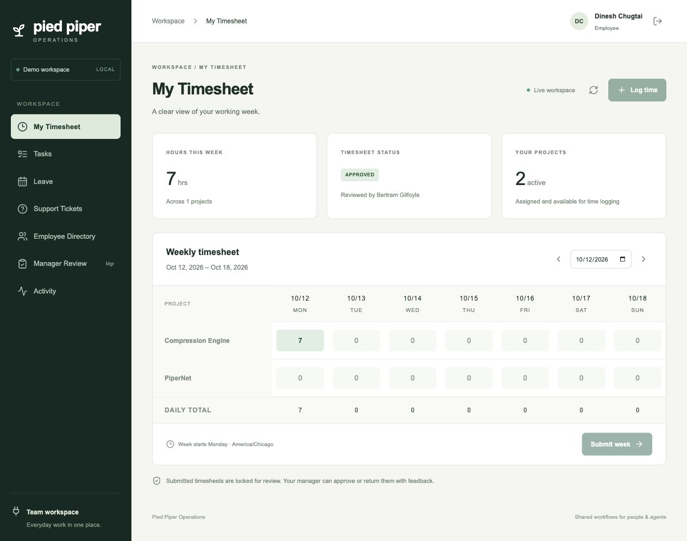
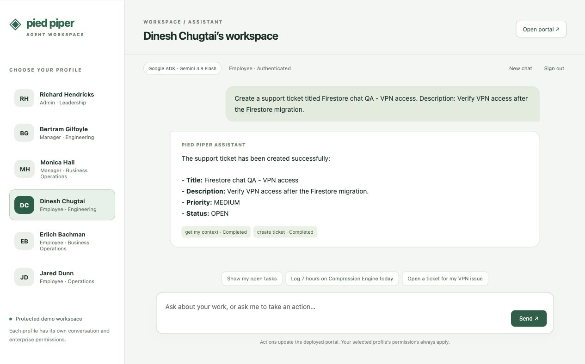
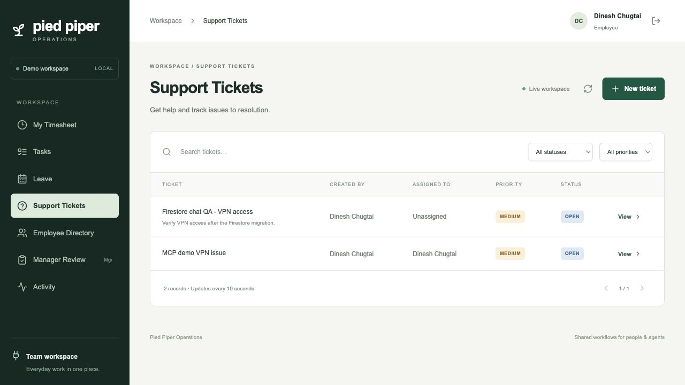

# Firestore migration verification — October 12, 2026

## Automated results

| Gate | Result |
|---|---|
| Python lint and formatting | Passed |
| Emulator backend / REST / MCP suite | 168 passed |
| Emulator ADK chat suite | 13 passed |
| TypeScript | Passed |
| Production Next.js build and browser suite | 18 passed |
| Real Firestore backend / REST / MCP suite | 164 passed; this run collected before four storage tests were added |
| Real Firestore additional storage and final concurrency checks | 8 passed |
| Real Firestore chat suite | 13 passed |
| ADK environment dependency check | No broken requirements |

The existing permission/workflow assertions remain intact. Tests now bind document sessions to unique `test-` namespaces rather than SQL databases. Real tests use the dedicated `enterprise-portal` database, never AI Lab's existing default database. The full `make verify` release gate exited successfully.

Coverage includes all tool schemas and annotations, REST/MCP parity and sources, authentication/origins/scopes, revocation/expiry, persona separation, partial task edits, daily hour limits, leave overlap, simultaneous approvals and retries, audit rollback, dates/precision, week uniqueness, split chat history, migration checksum failure, and UI refresh after external MCP writes.

## Migration and recovery

All 48 cloud-source records were preserved: 6 users, 11 credentials, 7 conversations, 2 projects, 12 memberships, 1 timesheet, 1 time entry, 1 task, 5 audit events and 2 retry records. Leave/ticket collections were empty before acceptance demonstrations. Existing UUIDs, timestamps, hours, histories and credential hashes were preserved.

The final export/import and subsequent download/restore matched SHA-256 `9b0ffcebc250eb4b0a38034d29d4e23b4d16dddbccf7282fcc069635c4163d16`. Final SQL writes were frozen and active turns checked before export. The private recovery copy is `gs://enterprise-portal-migration-backup-265050340558/sql-final-2026-10-12.json`, protected by uniform bucket access and public-access prevention. No credential payloads are tracked in Git.

Cloud SQL `enterprise-portal-db` was deleted after cutover, live demos and recovery verification. The SQL connection secret and both runtime Cloud SQL permissions were removed. The initialization job now seeds Firestore. The existing default Firestore database and unrelated project applications were not modified.

## Deployed acceptance

The production revisions use tag `20261012-firestore-v4`, Firestore Standard/Native in `us-central1`, and database-scoped workload identity. Chat `/health` returned storage `firestore`. Persona lookup returned all six users. Services remain IAM-private with zero minimum and two maximum instances.

The real three-persona HTTP MCP demonstration passed:

- Dinesh discovered Compression Engine, logged seven hours without a description, retried the same key, and submitted October 12's sheet. Gilfoyle approved it.
- Assigned task was completed.
- Leave was requested and rejected with a reason.
- Ticket was created, assigned, closed directly and reopened.
- Directory/manager lookup, historical sheets, pending approvals and MCP activity worked.
- Self-approval, unauthorized access and employee ticket assignment were denied.

The deployed portal visibly showed the approved seven-hour sheet and the DONE task. A real ADK/Gemini browser request created `Firestore chat QA - VPN access`; the ticket appeared automatically in the already-open portal without reloading. Reloading the chat restored the complete request/reply and tool-result indicators from Firestore.

## Measured write-operation document IO

Measured against real Firestore in a disposable namespace, excluding separate HTTP authentication/rate-counter work. Counts describe SDK document operations, not an invoice or all index/network charges.

| Operation | Reads | Writes |
|---|---:|---:|
| Initial seven-hour entry with retry key | 12 | 6 |
| Identical entry retry | 6 | 1 |
| Submit sheet | 7 | 3 |
| Approve sheet | 8 | 3 |
| Create ticket with retry key | 6 | 4 |

The retry's one write updates only the coordination guard: it creates no second entry, retry record or success audit. Large payload fields are exempted from indexes. This named database has no free-tier quota; billing is usage-based, with no reserved database compute. Exact totals and substring matching currently scan indexed candidate documents, so larger histories can increase reads. Hidden portal tabs stop polling. No spending cap is implied by Cloud Run instance limits.

## Issues found and fixed

- Buffered writes initially selected an empty SDK transaction as false; selecting explicitly by `is not None` fixed atomic persistence.
- Chat listing relied on SQLAlchemy's `.all()`; it now handles document results.
- Live dependencies required a compatible API-core version with ADK; the requirements resolver and dependency check pass.
- Retry exhaustion is surfaced as SDK `ValueError` caused by `Aborted`; it now maps to a safe 409 conflict.
- Read-only operations no longer acquire unnecessary write transactions.
- A stale local test port interrupted one MCP browser run; the harness now allocates its MCP port dynamically. The complete final browser gate passed.

## Local runtime and final checks

The local Docker PostgreSQL stack was replaced by the emulator, rebuilt REST/MCP services and frontend. All 26 local reference/credential records were preserved and matched checksum `0a4c8deb38684086b8060531e1432817af946fe4aac2de16aa4488edeab72efd`. The original SQL volume and protected JSON export remain available locally. The emulator's explicit snapshot wrapper was tested across restart and preserved every record. Local backend/MCP health checks passed.

Nine final storage/concurrency tests passed, including a simultaneous eight-request cold start that initializes exactly one shared client factory. This adds one test to the final CI backend total. GitHub CI is being finalized. The optional billing-alert threshold/recipient are awaiting user preference.
